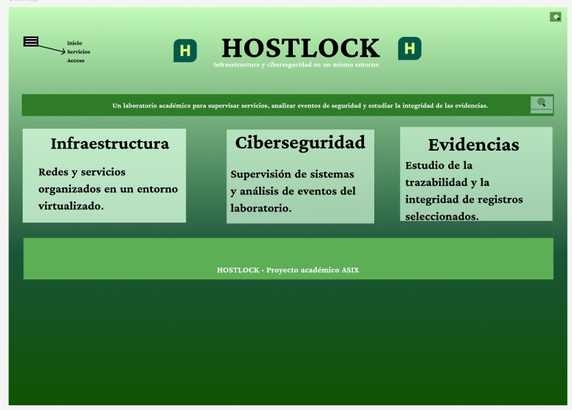
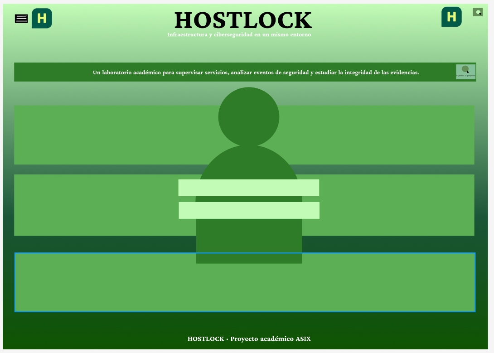
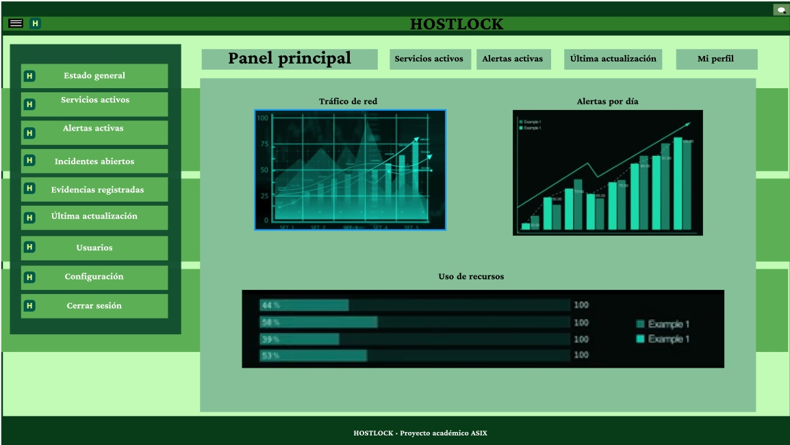
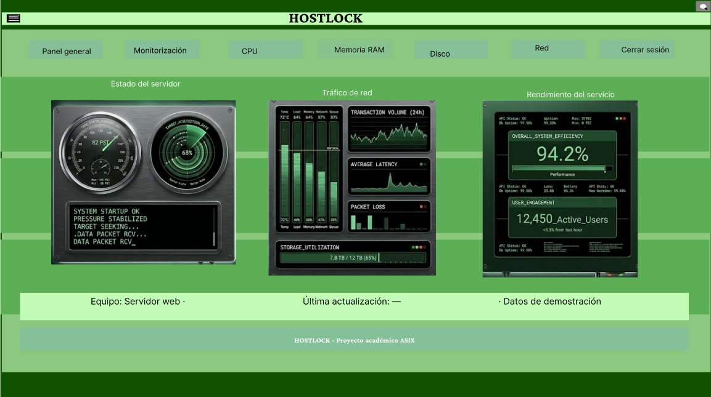

# Diseño de la interfaz de HOSTLOCK

Equipo: Deivid Arley Cardona Pérez, Luis Alberto Rodríguez Aguilar y Pau Toledano Tortajada.

[Volver a la portada del proyecto](../README.md) · [Ver diseño de referencia en Figma](https://www.figma.com/design/lSyFDomQELzVXsKalm0OQp/)

## Objetivo y alcance

Definir la interfaz de HOSTLOCK, las funciones de sus elementos, la navegación y los datos visibles según el perfil. Figma actúa como referencia visual de la futura web; las capturas no representan una aplicación implementada.

El diseño comprende Inicio, Servicios, Acceso, Panel general y Monitorización. No requiere páginas independientes de administración, incidentes o evidencias en esta entrega.

## Colores y tipografía

Se conserva la identidad verde utilizada en Figma. La siguiente paleta toma los rellenos del mockup de Monitorización como referencia:

| Color | HEX | Aplicación |
|---|---|---|
| Verde oscuro | #0F5301 | Fondo base y zonas de cierre visual. |
| Verde medio | #5DAF55 | Franjas y bloques de contenido. |
| Verde suave | #86C098 | Indicadores e información secundaria. |
| Verde claro | #C2FBB6 | Barra superior y superficies claras. |
| Negro | #000000 | Texto e iconos sobre fondos claros. |
| Blanco | #FFFFFF | Textos destacados sobre fondos verdes. |

La paleta relaciona visualmente las pantallas y distingue navegación, contenido e información secundaria. Los degradados y transparencias producen variaciones sobre los colores base; las imágenes conservan sus propios tonos. Inter se utiliza en las etiquetas de Monitorización e Idiqlat en la marca y el pie de esa pantalla. Esta descripción no supone una evaluación formal de accesibilidad.

## Funcionalidades

- Presentación pública de HOSTLOCK y sus áreas de trabajo.
- Acceso previsto mediante usuario y contraseña.
- Consulta del Panel general según el perfil.
- Monitorización detallada para administrador y analista SOC.
- Resumen de servicios para usuario básico.
- Cierre de sesión y regreso a Acceso.

## Mapa del sitio

```text
Inicio
├── Servicios — público
└── Acceso
    ├── Administrador / Analista SOC
    │   └── Panel general completo
    │       ├── Monitorización
    │       └── Cerrar sesión → Acceso
    └── Usuario básico
        └── Panel general resumido
            └── Cerrar sesión → Acceso
```

## Perfiles

| Perfil | Información visible y acceso previsto |
|---|---|
| Administrador | Panel completo y Monitorización detallada. |
| Analista SOC | Los mismos datos de consulta, sin funciones de administración. |
| Usuario básico | Estado general de los servicios, sin gráficos detallados ni métricas de CPU, RAM, disco o red y sin acceso a Monitorización. |

Administrador y analista comparten la vista de consulta, con el rol identificado. La vista resumida es una variante del Panel general, no otra página.

## Boceto inicial

[Archivo aportado: Hostlock — papel (HTML)](./evidencias/Hostlock-%20papel.html)

## Pantallas y funcionamiento

### 1. Inicio

Presentación prevista de HOSTLOCK. Permite ir a Servicios para conocer las áreas del proyecto y a Acceso para entrar en la zona privada.

#### Wireframe

#### Mockup

### 2. Servicios



La pantalla pública presenta HOSTLOCK y tres tarjetas: Infraestructura, Ciberseguridad y Evidencias. Todos los visitantes ven la misma información, sin registros privados.

| Tarjeta | Texto visible |
|---|---|
| Infraestructura | Redes y servicios organizados en un entorno virtualizado. |
| Ciberseguridad | Supervisión de sistemas y análisis de eventos del laboratorio. |
| Evidencias | Estudio de la trazabilidad y la integridad de registros seleccionados. |

La cabecera muestra el lema «Infraestructura y ciberseguridad en un mismo entorno». La presentación describe el laboratorio académico y el pie identifica el proyecto ASIX.

Las tarjetas son informativas, no botones. Inicio vuelve a la presentación; Servicios identifica esta sección; Acceso abre el formulario; el menú permite mostrar u ocultar la navegación. El elemento «Explorar el proyecto» que permanece en la referencia gráfica no forma parte del funcionamiento acordado.

#### Wireframe

### 3. Acceso



La referencia representa dos campos sobre un icono de usuario. En la web, el primero corresponde a Usuario y el segundo a Contraseña. El usuario escrito será visible y la contraseña se mostrará oculta. La acción Entrar comprobará las credenciales y conducirá al panel según el perfil. Un error mantendrá el formulario con un aviso; volver a Inicio permitirá salir del acceso.

La captura es una guía de composición: las etiquetas y la acción de entrada se definen aquí sin afirmar que ya aparezcan completas en la imagen. Los tres perfiles utilizan el mismo formulario.

#### Wireframe

### 4. Panel general



La vista de referencia muestra HOSTLOCK, navegación lateral, servicios activos, alertas activas, última actualización y Mi perfil. El área central representa Tráfico de red, Alertas por día y Uso de recursos.

| Información | Función prevista |
|---|---|
| Servicios activos | Resumir los servicios disponibles. |
| Alertas activas | Resumir los avisos de seguridad. |
| Última actualización | Indicar el momento de actualización de los datos. |
| Tráfico de red | Representar la evolución de las comunicaciones. |
| Alertas por día | Representar el número de alertas por fecha. |
| Uso de recursos | Representar la utilización de recursos del equipo. |
| Mi perfil | Identificar al usuario y su rol dentro del panel, sin otra página. |

Administrador y analista ven esta consulta completa. El usuario básico dispone de una variante resumida con el estado general de los servicios y Cerrar sesión, sin gráficos detallados ni acceso a Monitorización.

La navegación funcional de esta entrega se limita a Panel general, Monitorización para los perfiles autorizados y Cerrar sesión hacia Acceso. Las etiquetas de Usuarios, Configuración, Incidentes y Evidencias de la referencia visual no implican pantallas ni acciones implementadas dentro del alcance acordado. Los gráficos son ilustrativos.

#### Wireframe

#### Vista resumida del usuario básico

### 5. Monitorización



La pantalla presenta tres bloques: Estado del servidor, Tráfico de red y Rendimiento del servicio. Las imágenes representan el tipo de información a consultar, no mediciones reales del laboratorio.

| Elemento | Funcionamiento previsto |
|---|---|
| Panel general | Volver al resumen del panel. |
| Monitorización | Identificar la pantalla actual. |
| CPU | Información sobre utilización del procesador. |
| Memoria RAM | Información sobre utilización de memoria. |
| Disco | Información sobre ocupación del almacenamiento. |
| Red | Información sobre tráfico de comunicaciones. |
| Cerrar sesión | Regresar a Acceso. |

CPU, Memoria RAM, Disco y Red son etiquetas informativas, no botones. No abren otras pantallas. La franja inferior identifica Servidor web, Última actualización: — y Datos de demostración. El pie identifica HOSTLOCK como proyecto académico ASIX.

Administrador y analista pueden consultar Monitorización; el usuario básico no dispone de este acceso detallado.

#### Wireframe

## Navegabilidad y pruebas previstas

La navegación se define mediante nombres consistentes, regreso al panel y visibilidad según el perfil. Las siguientes comprobaciones son propuestas para demostrar el funcionamiento esperado, no pruebas ejecutadas de una aplicación real.

| Escenario | Recorrido o acción | Resultado esperado |
|---|---|---|
| Visitante | Inicio → Servicios → Acceso. | Consulta los tres bloques públicos y llega al formulario sin ver datos internos. |
| Administrador | Acceso → Panel completo → Monitorización → Panel → Cerrar sesión. | Consulta los indicadores y regresa a Acceso. |
| Analista SOC | Acceso → Panel completo → Monitorización → Cerrar sesión. | Consulta datos operativos sin funciones de administración. |
| Usuario básico | Acceso → Panel resumido → Cerrar sesión. | Solo ve estado general, sin métricas detalladas ni acceso a Monitorización. |
| Error de acceso | Introducir credenciales incorrectas y pulsar Entrar. | Permanece en Acceso y recibe un aviso de error. |

## Evidencias

[Consultar archivos de capturas y boceto](./evidencias/)
