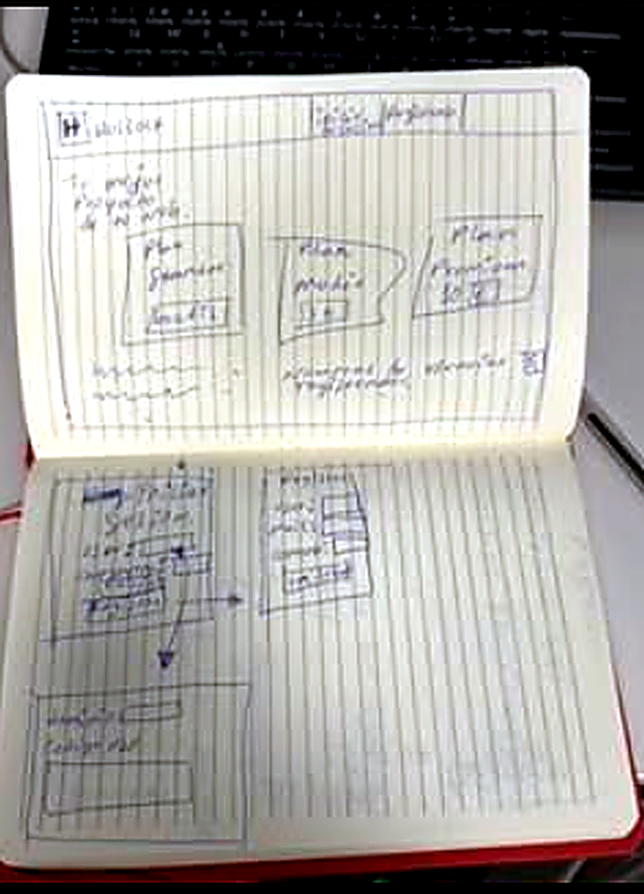

# Diseño de la interfaz de HOSTLOCK

Equipo: Deivid Arley Cardona Pérez, Luis Alberto Rodríguez Aguilar y Pau Toledano Tortajada.

[Volver a la portada del proyecto](../README.md) · [Ver diseño de referencia en Figma](https://www.figma.com/design/lSyFDomQELzVXsKalm0OQp/)

## Objetivo y organización

El diseño de HOSTLOCK organiza la presentación del proyecto, el acceso de los usuarios y la consulta del estado de los servicios. Este documento describe la estructura de las pantallas y el comportamiento definido para su navegación.

La interfaz se distribuye en cinco pantallas: Inicio, Servicios, Acceso, Panel general y Monitorización. Inicio y Servicios forman la zona pública. Acceso conecta esa zona con el panel correspondiente a cada perfil. Desde el panel, administrador y analista SOC pueden consultar Monitorización y regresar al resumen.

## Colores y tipografía

La identidad visual utiliza una paleta de verdes para relacionar las pantallas y distinguir navegación, contenido e información secundaria. La siguiente paleta toma los rellenos del mockup de Monitorización como referencia:

| Color | HEX | Aplicación |
|---|---|---|
| Verde oscuro | #0F5301 | Fondo base y zonas de cierre visual. |
| Verde medio | #5DAF55 | Franjas y bloques de contenido. |
| Verde suave | #86C098 | Indicadores e información secundaria. |
| Verde claro | #C2FBB6 | Barra superior y superficies claras. |
| Negro | #000000 | Texto e iconos sobre fondos claros. |
| Blanco | #FFFFFF | Textos destacados sobre fondos verdes. |

Los degradados y transparencias producen variaciones sobre los colores base; las imágenes conservan sus propios tonos. Inter se utiliza en las etiquetas de Monitorización e Idiqlat en la marca y el pie de esa pantalla.

## Mapa del sitio

```text
Inicio
├── Servicios — público
└── Acceso
    ├── Administrador / Analista SOC
    │   └── Panel general completo
    │       ├── Monitorización → Panel general
    │       └── Cerrar sesión → Acceso
    └── Usuario básico
        └── Panel general resumido
            └── Cerrar sesión → Acceso
```

## Perfiles y acceso a la información

| Perfil | Vista del panel | Navegación |
|---|---|---|
| Administrador | Servicios, alertas, tráfico de red y uso de recursos. | Panel general, Monitorización y Cerrar sesión. |
| Analista SOC | Los mismos datos de consulta del panel completo, con un rol centrado en el análisis. | Panel general, Monitorización y Cerrar sesión. |
| Usuario básico | Resumen del estado general de los servicios. | Panel resumido y Cerrar sesión. |

Administrador y analista comparten la vista de consulta, con su rol identificado. El usuario básico dispone de una variante resumida del Panel general. Las métricas detalladas de CPU, RAM, disco y red corresponden a la vista de Monitorización de administrador y analista.

## Boceto inicial

El boceto en papel recoge la primera distribución visual del diseño y sirve como referencia para organizar las pantallas.



[Ver la fotografía del boceto en tamaño completo](./evidencias/foto.png)

[Archivo aportado: Hostlock — papel (HTML)](./evidencias/Hostlock-%20papel.html)

## Pantallas y funcionamiento

### 1. Inicio

Inicio presenta HOSTLOCK y constituye el punto de entrada a la zona pública. Desde esta pantalla, el visitante puede conocer las áreas del proyecto mediante Servicios o dirigirse a Acceso para entrar en la zona privada.

| Opción | Destino o función en el diseño |
|---|---|
| Servicios | Abrir la presentación de las tres áreas del proyecto. |
| Acceso | Abrir el formulario de usuario y contraseña. |

### 2. Servicios


Servicios presenta las tres áreas de HOSTLOCK mediante tarjetas informativas. El contenido es común para todos los visitantes.

| Tarjeta | Texto visible |
|---|---|
| Infraestructura | Redes y servicios organizados en un entorno virtualizado. |
| Ciberseguridad | Supervisión de sistemas y análisis de eventos del laboratorio. |
| Evidencias | Estudio de la trazabilidad y la integridad de registros seleccionados. |

La cabecera incorpora HOSTLOCK y el lema «Infraestructura y ciberseguridad en un mismo entorno». El pie identifica el proyecto académico ASIX.

| Opción | Destino o función en el diseño |
|---|---|
| Inicio | Volver a la presentación del proyecto. |
| Servicios | Identificar la sección actual. |
| Acceso | Abrir el formulario de entrada. |
| Menú | Mostrar u ocultar las opciones de navegación. |

Las tarjetas se utilizan para leer la descripción de cada área. El recorrido entre pantallas se realiza mediante la navegación de la cabecera.

### 3. Acceso


Acceso reúne los campos Usuario y Contraseña. El nombre de usuario se muestra en texto y la contraseña se oculta durante la escritura. Los tres perfiles comparten el mismo formulario.

El flujo de entrada definido consiste en introducir las credenciales y seleccionar Entrar. Las credenciales correctas conducen al Panel general correspondiente al perfil. Ante credenciales incorrectas, el flujo mantiene el formulario y muestra un aviso para corregir los datos.

| Elemento | Función en el diseño |
|---|---|
| Usuario | Introducir el identificador de la cuenta. |
| Contraseña | Introducir la clave con los caracteres ocultos. |
| Entrar | Solicitar el acceso al panel correspondiente al perfil. |
| Inicio | Regresar a la zona pública. |

### 4. Panel general


El Panel general concentra el resumen de los servicios y la información de supervisión. La composición combina cabecera HOSTLOCK, navegación lateral e indicadores centrales.

| Información | Función en el diseño |
|---|---|
| Servicios activos | Resumir los servicios disponibles. |
| Alertas activas | Resumir los avisos de seguridad. |
| Última actualización | Identificar el momento de actualización de la información. |
| Tráfico de red | Representar la evolución de las comunicaciones. |
| Alertas por día | Representar la distribución de alertas por fecha. |
| Uso de recursos | Representar la utilización de recursos del equipo. |
| Mi perfil | Identificar al usuario y su rol dentro del panel. |

Administrador y analista consultan la vista completa. Desde ella, Monitorización conduce al detalle del equipo y Panel general permite volver al resumen. Cerrar sesión devuelve al formulario de Acceso.

La navegación descrita se centra en estas cinco pantallas. Los resúmenes de servicios y alertas se consultan dentro del propio panel.

#### Vista del usuario básico

La variante resumida presenta el estado general de los servicios para una consulta sencilla. Su recorrido conecta Acceso con el Panel resumido y termina en Cerrar sesión, que devuelve a Acceso. El detalle de recursos se concentra en la vista de los perfiles técnicos.

### 5. Monitorización


Monitorización agrupa tres bloques: Estado del servidor, Tráfico de red y Rendimiento del servicio. Los gráficos y cifras de las capturas son datos de demostración que ilustran la presentación de los indicadores.

| Elemento | Destino o función en el diseño |
|---|---|
| Panel general | Regresar al resumen de servicios e indicadores. |
| Monitorización | Identificar la pantalla actual. |
| CPU | Identificar la información sobre utilización del procesador. |
| Memoria RAM | Identificar la información sobre utilización de memoria. |
| Disco | Identificar la información sobre ocupación del almacenamiento. |
| Red | Identificar la información sobre tráfico de comunicaciones. |
| Cerrar sesión | Regresar a Acceso. |

CPU, Memoria RAM, Disco y Red son etiquetas informativas. Los cambios de pantalla se realizan con Panel general y Cerrar sesión.

La franja inferior identifica el equipo Servidor web, la última actualización y el carácter demostrativo de los datos. El pie muestra «HOSTLOCK · Proyecto académico ASIX».

## Navegabilidad

La navegación conecta la consulta pública con el acceso privado y adapta la información al perfil del usuario. Cada pantalla tiene una función concreta y un recorrido de salida: volver a Inicio desde la zona pública, regresar al Panel general desde Monitorización o cerrar la sesión para volver a Acceso.

### Recorrido público

1. El visitante entra en Inicio y conoce la presentación de HOSTLOCK.
2. Selecciona Servicios para consultar Infraestructura, Ciberseguridad y Evidencias.
3. Puede regresar a Inicio o seleccionar Acceso para abrir el formulario.

### Recorrido de administrador y analista SOC

1. El usuario introduce sus credenciales en Acceso.
2. Entrar conduce al Panel general completo según su perfil.
3. Desde el panel, selecciona Monitorización para consultar el detalle del equipo.
4. Panel general permite regresar al resumen.
5. Cerrar sesión finaliza el recorrido y devuelve a Acceso.

### Recorrido del usuario básico

1. El usuario entra mediante el formulario de Acceso.
2. Consulta el estado de los servicios en el Panel general resumido.
3. Selecciona Cerrar sesión para regresar a Acceso.

### Tratamiento del error de acceso

Si las credenciales son incorrectas, el flujo permanece en Acceso y presenta un aviso. El usuario puede corregir los campos y volver a seleccionar Entrar, o regresar a Inicio.

## Evidencias

[Consultar archivos de capturas y boceto](./evidencias/)
